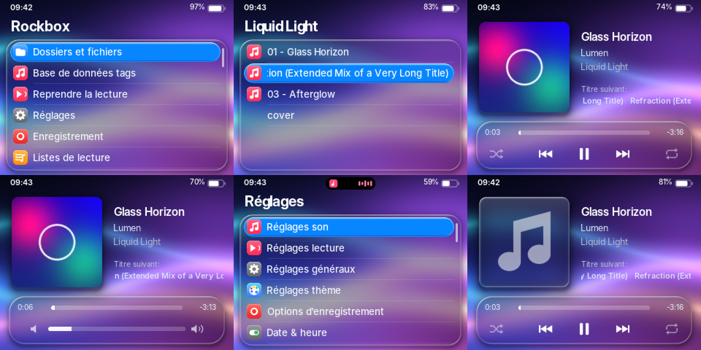
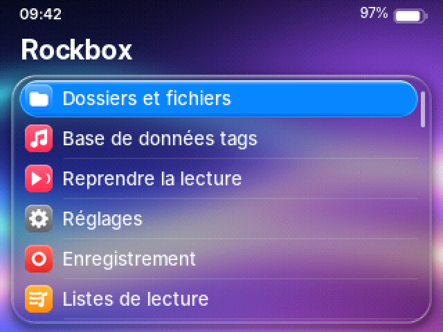
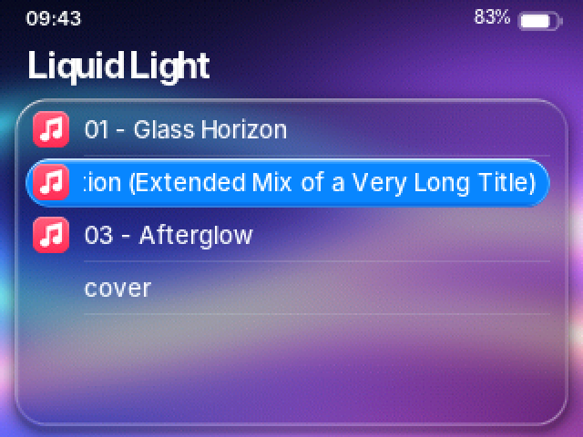
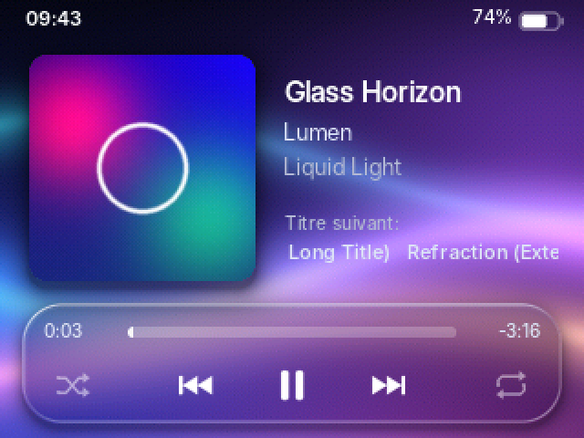
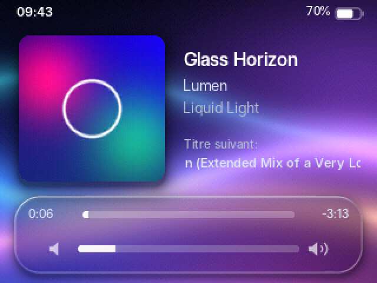
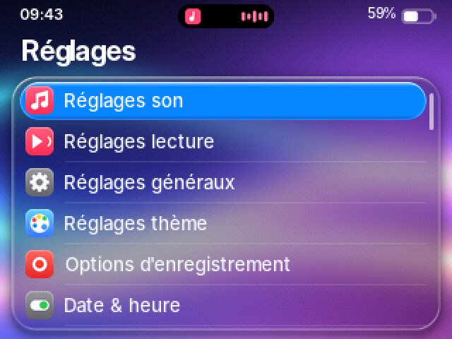
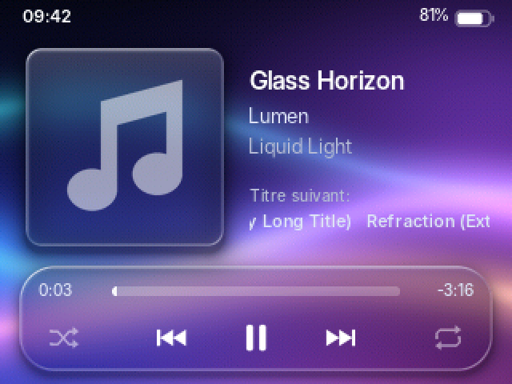

# Liquid Glass — un iPod nano 3G façon iOS 27

Un thème complet pour **Rockbox** qui donne à l'iPod nano de 3ᵉ génération
(le « gros » nano carré, écran 2 pouces 320×240) l'allure d'iOS 27 : panneaux
de verre dépoli avec reflets sur les bords, grand titre, icônes en tuiles
colorées, pastille de sélection bleue, « Dynamic Island » pendant la lecture,
pochette aux coins arrondis et lecteur en verre.



Toutes les captures viennent du **simulateur officiel de Rockbox** réglé en
français (moteur de rendu réel, pas une maquette), agrandies ×2 :

| Menu principal | Album | Lecture |
| --- | --- | --- |
|  |  |  |
| **Volume** | **Réglages** | **Sans pochette** |
|  |  |  |

## Pourquoi Rockbox (et pas iPodLinux)

- **iPodLinux** n'a jamais fonctionné sur le nano 3G (le projet s'est arrêté
  avant, et ce modèle a un processeur différent). Ce n'est pas une option.
- **Rockbox** est un vrai système d'exploitation libre pour baladeurs. Depuis
  septembre 2026, il démarre sur le nano 3G (pilote de mémoire flash, son,
  batterie, horloge). C'est lui qui fait tourner l'iPod ; ce dossier en change
  toute l'interface.

Écrire un OS de zéro n'aurait rien apporté : Rockbox gère déjà la lecture
(MP3, AAC, FLAC, Opus…), l'égaliseur, la base de données et les playlists. Le
travail porte donc sur ce qui se voit.

## ⚠️ À lire avant d'installer

Le portage nano 3G de Rockbox est **expérimental** :

- **Seules certaines puces mémoire sont validées.** Apple a monté plusieurs
  modèles de puce NAND sur ce nano. Le premier validé est le 4 Go Hynix
  `A514D3AD`, et la liste s'allonge. Si la puce de ton iPod n'est pas
  reconnue, le bootloader affiche un QR code (vers `rockbox.org/IPNBL`) et
  démarre le système d'Apple **sans toucher au stockage**.
- Le bootloader est en **double démarrage** : le système d'Apple reste là.
- Le rafraîchissement préventif des blocs et le remappage des blocs
  défectueux n'ont pas encore été éprouvés sur du vrai matériel.
  **Garde une sauvegarde de ta musique.**
- Il n'existe pas encore de build officiel téléchargeable pour ce modèle :
  il faut compiler Rockbox (voir ci‑dessous). La page d'aide
  `https://rockbox.org/IPNBL` renvoie vers des bootloaders non officiels
  (freemyipod.org) et leurs instructions. Vérifie l'état du portage sur
  rockbox.org au moment d'installer : il évolue vite.

## Installation

### 1. Vérifier l'iPod

- Modèle **A1236** (au dos), écran 2″, boîtier large et court.
- L'iPod doit être formaté **pour Windows (FAT32)**. S'il a été initialisé
  sur un Mac, restaure-le depuis un PC (iTunes ou l'app Appareils Apple).

### 2. Installer Rockbox

Suis le manuel Rockbox, section « iPod Nano 3G »
(`manual/getting_started/ipodnano3g_install.tex` dans les sources). En bref :

1. Compiler Rockbox pour la cible `ipodnano3g` (`tools/configure`, puis
   `make zip`) et le bootloader (`bootloader-ipodnano3g.ipod`), ou récupérer
   le bootloader depuis la page d'aide ci-dessus.
2. Décompresser `rockbox.zip` à la racine de l'iPod (dossier `.rockbox`).
3. Installer le bootloader avec **`mks5lboot`** (et surtout pas
   `ipodpatcher`) :
   ```bash
   mks5lboot --dfuscan --loop      # passer l'iPod en mode DFU, Ctrl+C une fois détecté
   mks5lboot --bl-inst bootloader-ipodnano3g.ipod
   ```
4. L'iPod redémarre sous Rockbox.

### 3. Installer le thème

1. Copier le contenu de [`installer/.rockbox`](installer/.rockbox) dans le
   dossier `.rockbox` de l'iPod, en **fusionnant** les dossiers (rien n'est
   écrasé : tous les fichiers du thème sont nouveaux).
   > Le dossier commence par un point : il est masqué par défaut
   > (macOS : `Cmd` + `Maj` + `.` dans le Finder).
2. Rockbox démarre en anglais. Pour passer en français : **Settings ›
   General Settings › Language › francais**. Le thème reprend les textes de
   Rockbox, donc tout suit (« Titre suivant », menus, réglages…).
3. Activer le thème : **Réglages › Réglages thème › Liste des thèmes ›
   LiquidGlass** (en anglais : *Settings › Theme Settings › Browse Theme
   Files*).

Pour régler l'heure affichée en haut à gauche : *Réglages › Date & heure*.

## Ce que fait le thème

| Élément | Détail |
| --- | --- |
| Fond | rubans lumineux bleu/violet/rose sur bleu nuit, tramés en RGB565 pour éviter les bandes |
| Verre | flou, réfraction sur les bords, vibrance, reflet spéculaire en haut à gauche, ombre portée |
| Barre d'état | heure, pourcentage et pile façon iOS (verte en charge, rouge sous 20 %), cadenas si *Hold* |
| Dynamic Island | capsule noire animée en haut des menus pendant la lecture (onde, pause, avance rapide) |
| Listes | grand titre, 6 lignes, séparateurs fins, pastille bleue avec reflet, défilement des noms longs, indicateur de défilement |
| Icônes | 32 tuiles 20×20 dans l'esprit iOS (dossier, musique, réglages, thème, enregistrement…) |
| Lecture | pochette arrondie avec ombre, titre/artiste/album, morceau suivant, barre de progression, aléatoire/répétition, jauge de volume qui remplace les commandes pendant 2 s |
| Polices | Inter (la plus proche de SF Pro), anticrénelée, latin + grec + cyrillique |

### Limites (dues au matériel ou au moteur de Rockbox)

- **Pas de flou en temps réel** : le processeur du nano ne le permet pas.
  Le verre est pré-calculé sur un fond fixe ; le fond ne suit donc pas la
  pochette comme sur iPhone.
- Rockbox mélange la transparence des images avec le **fond d'écran**, pas
  avec ce qui est déjà affiché. Le générateur en tient compte : coins de
  pochette rognés par fines bandes opaques, icônes de la ligne choisie
  pré-composées sur le bleu.
- Pas d'écran radio : le nano 3G n'a pas de tuner FM intégré.

## Modifier le thème

Tout est produit par deux scripts. Ne modifie pas les fichiers de
`installer/` à la main : ils sont régénérés.

```bash
cd ipod-liquid-glass/generateur
python3 build.py      # images, fond, icônes, .wps/.sbs/.cfg (Pillow + numpy)
sh polices.sh         # polices .fnt (compile l'outil convttf de Rockbox ; FreeType)
```

Dans `build.py` :

- `BLUE` : couleur de la pastille de sélection (essaie `(255, 55, 95)` pour
  du rose) ;
- `wallpaper()` : le fond (taches et rubans de couleur) ;
- `glass()` : opacité, flou et reflets du verre ;
- `ICONS` : couleurs et dessins des icônes ;
- les constantes en haut du fichier : toutes les positions à l'écran.

## Comment ça a été testé

- Les deux skins passent **`checkwps`** (le validateur de Rockbox) compilé
  pour la cible **`ipodnano3g`**.
- Rendu vérifié dans le **simulateur Rockbox de l'iPod Classic**, qui a le
  même écran 320×240 en 16 bits et la même molette (Rockbox n'a pas encore
  de simulateur nano 3G) : menus, navigation, lecture avec et sans pochette,
  pause, volume, réglages, boîtes de dialogue.
- Pas encore testé sur un vrai nano 3G : c'est l'étape suivante.

## Contenu du dossier

```
ipod-liquid-glass/
├── installer/.rockbox/       ← à copier sur l'iPod
│   ├── themes/LiquidGlass.cfg
│   ├── wps/LiquidGlass.wps   écran de lecture
│   ├── wps/LiquidGlass.sbs   barre d'état + menus
│   ├── wps/LiquidGlass/      images du thème
│   ├── backdrops/LiquidGlass.bmp
│   ├── icons/LiquidGlass.bmp
│   └── fonts/                Inter en .fnt + licence OFL
├── generateur/
│   ├── build.py              génère tout le thème
│   └── polices.sh            génère les polices
└── apercus/                  captures du simulateur
```

## Licences

- Thème (images, skins, scripts) : créé pour ce projet.
- Polices : **Inter**, © The Inter Project Authors, licence SIL OFL 1.1
  (`installer/.rockbox/fonts/Inter-OFL.txt`).
- Rockbox est un logiciel libre sous GPL v2 ; il n'est pas inclus ici.
- Aucun élément graphique d'Apple n'est utilisé : le style est inspiré
  d'iOS, mais tout est dessiné par le script.
