# Liquid Glass — un iPod nano 2G façon iOS 27

Le thème **Rockbox** « Liquid Glass » du nano 3G, adapté à l'iPod nano de
**2ᵉ génération** (le nano fin en aluminium, écran 1,5 pouce 176×132) :
panneaux de verre dépoli avec reflets sur les bords, grand titre, icônes en
tuiles colorées, pastille de sélection bleue, « Dynamic Island » pendant la
lecture, pochette aux coins arrondis et lecteur en verre.

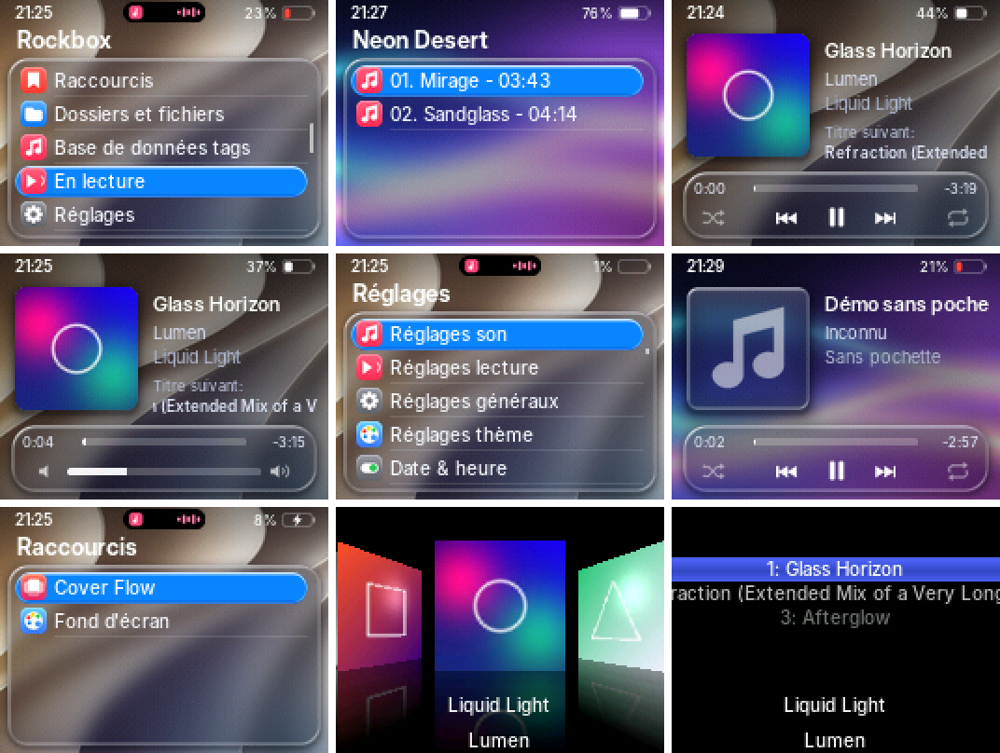

Toutes les captures viennent du **simulateur officiel de Rockbox pour le nano
2G**, réglé en français (moteur de rendu réel, pas une maquette), agrandies ×2 :

| Menu principal | Album | Lecture |
| --- | --- | --- |
| 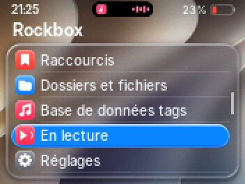 | 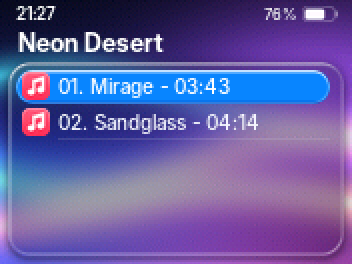 | 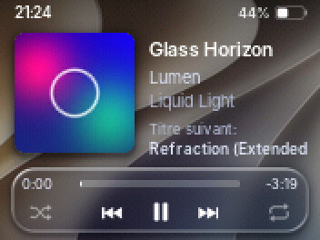 |
| **Volume** | **Réglages** | **Sans pochette** |
| 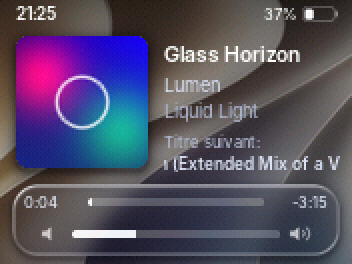 | 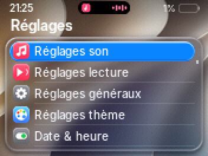 | 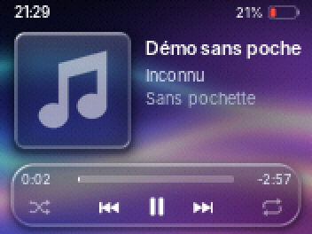 |
| **Raccourcis** | **Cover Flow** | **Pistes de l'album** |
| 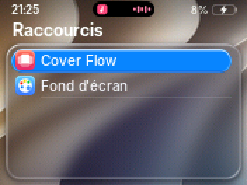 | 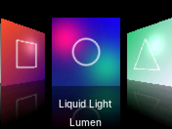 | 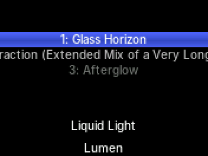 |

## Ce qui change par rapport au nano 3G

L'écran du nano 2G est presque deux fois plus petit (176×132 contre
320×240). Tout a été redessiné à cette taille, pas simplement réduit :

| | nano 3G | nano 2G |
| --- | --- | --- |
| Lignes de menu visibles | 6 (29 px) | 5 (18 px) |
| Icônes | 20×20 | 14×14 |
| Police des menus | Inter 16 | Inter 12 |
| Grand titre | Inter Display 24 | Inter Display 15 |
| Pochette | 124×124 | 66×66 |
| Barre d'état, île, commandes | taille d'origine | mêmes dessins, réduits et ré-alignés au pixel |

Le reste est identique : les 5 fonds d'écran, le Cover Flow, le changement
de fond depuis les Raccourcis, la jauge de volume, le texte en français.

Bonne nouvelle : sur le nano 2G, Rockbox est un **portage stable et
officiel**. L'installation est bien plus simple que sur le nano 3G (voir
plus bas), sans risque pour le stockage.

## Essayer sans iPod

[`emulateur/`](emulateur) contient un **émulateur web** : un iPod nano 2G avec
sa molette cliquable, qui reprend les vraies images et positions du thème
(menus, 5 fonds, Cover Flow, lecture, volume). Ce n'est pas Rockbox lui-même :
pas de son, et seuls les réglages de thème sont simulés. Pour le régénérer
après une modification : `python3 generateur/build.py && python3
generateur/export_web.py`.

## Installation

### 1. Vérifier l'iPod

- Modèle **A1199** (au dos), boîtier fin en aluminium anodisé, écran 1,5″
  en haut, molette en dessous. Existe en 2, 4 et 8 Go.
- L'iPod doit être formaté **pour Windows (FAT32)**. Rockbox ne sait pas
  s'installer sur un iPod initialisé sur un Mac (HFS+) : dans ce cas,
  restaure-le depuis un PC (iTunes ou l'app Appareils Apple).

### 2. Installer Rockbox

Le plus simple : **Rockbox Utility**, l'installateur officiel
(`https://www.rockbox.org/download/`, Windows, macOS et Linux).

1. Brancher l'iPod, lancer Rockbox Utility, cliquer sur **Autodetect**
   (il doit trouver « iPod Nano (2nd gen) »).
2. **Installation** › choisir la version stable (*Release*) › installer le
   **bootloader** et **Rockbox**. Le bootloader se met à côté du système
   d'Apple : rien n'est effacé.
3. Éjecter l'iPod : il redémarre sous Rockbox.

> Pour démarrer le système d'Apple, mettre le bouton **Hold** (ou maintenir
> **Menu**) pendant le démarrage. Pour revenir en arrière, Rockbox Utility
> propose *Uninstall*.

Méthode manuelle (si Rockbox Utility ne trouve pas l'iPod) : télécharger
`rockbox.zip` pour l'**iPod Nano 2G** sur rockbox.org et le décompresser à
la racine de l'iPod, puis installer le bootloader avec `ipodpatcher`
(fourni par le projet Rockbox), en administrateur. Le manuel Rockbox
détaille chaque étape (section « Installation », iPod).

### 3. Installer le thème

1. Copier le contenu de [`installer/.rockbox`](installer/.rockbox) dans le
   dossier `.rockbox` de l'iPod, en **fusionnant** les dossiers (tous les
   fichiers du thème sont nouveaux, sauf `shortcuts.txt` : voir Cover Flow).
   > Le dossier commence par un point : il est masqué par défaut
   > (macOS : `Cmd` + `Maj` + `.` dans le Finder).
2. Rockbox démarre en anglais. Pour passer en français : **Settings ›
   General Settings › Language › francais**. Le thème reprend les textes de
   Rockbox, donc tout suit (« Titre suivant », menus, réglages…).
3. Activer le thème : **Réglages › Réglages thème › Liste des thèmes ›
   LiquidGlass-Papier** (en anglais : *Settings › Theme Settings › Browse
   Theme Files*). Ensuite, le plus simple est de passer par
   **Raccourcis › Fond d'écran** (voir plus bas).

Pour régler l'heure affichée en haut à gauche : *Réglages › Date & heure*.

### 4. Changer de fond d'écran

Le thème existe en **5 versions**, une par fond d'écran. Pour en changer :
**Raccourcis › Fond d'écran**, puis choisis une ligne `LiquidGlass-…`.
Le fond change tout de suite, dans les menus comme sur l'écran de lecture.

| Thème | Fond |
| --- | --- |
| `LiquidGlass-Papier` | fond iOS 27 fourni (vagues de papier) |
| `LiquidGlass-Aurore` | rubans bleu, violet et rose sur bleu nuit (le premier fond) |
| `LiquidGlass-Ocean` | vagues turquoise et bleu profond |
| `LiquidGlass-Crepuscule` | coucher de soleil orange, rose et pourpre |
| `LiquidGlass-Graphite` | gris anthracite et reflets argentés, très sobre |

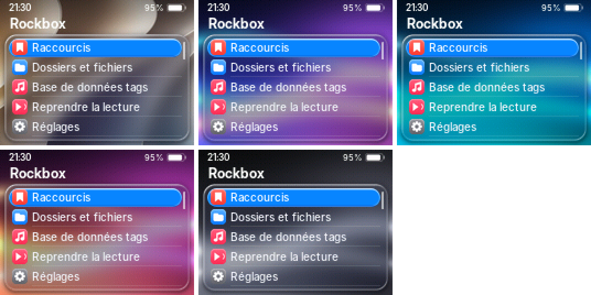

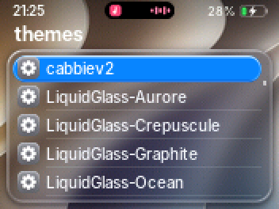

> Pourquoi un thème par fond ? Rockbox ne sait pas flouter en direct : le
> verre, la barre d'état et les commandes sont pré-calculés pour chaque fond.
> La liste montre aussi les thèmes livrés avec Rockbox (`cabbiev2`…) :
> les choisir quitte Liquid Glass.

### 5. Cover Flow

Cover Flow passe par **PictureFlow**, le plugin de Rockbox qui reprend
l'effet de l'iPod : pochettes en perspective, reflets, fond noir.
Le thème le place dans le menu principal : **Raccourcis › Cover Flow**.

1. Une seule fois : **Base de données tags** › confirmer l'initialisation,
   puis redémarrer l'iPod quand Rockbox le demande. Cover Flow liste les
   albums depuis cette base.
2. Au premier lancement, PictureFlow prépare le cache des pochettes
   (`cover.jpg` ou `folder.jpg` dans le dossier de l'album, ou pochette
   intégrée au fichier). Ça peut prendre un moment avec beaucoup d'albums.
3. **Molette** : faire défiler les pochettes ; **⏮ / ⏭** : sauter plus
   loin ; **bouton central** : ouvrir les pistes de l'album, puis lancer la
   lecture ; **Menu** : revenir.

> Le thème installe `.rockbox/shortcuts.txt` (raccourcis Cover Flow et Fond
> d'écran) et place « Raccourcis » en tête du menu principal (ligne
> `root menu order` des fichiers `themes/LiquidGlass-*.cfg`). Si tu avais déjà des raccourcis, ajoute
> plutôt le bloc `[shortcut]` de ce fichier à ton propre `shortcuts.txt`.
> PictureFlow garde son propre style (fond noir) : c'est un plugin, pas
> une page du thème. Pour que Cover Flow affiche le bon artiste, les
> morceaux doivent avoir le tag *artiste de l'album*.

## Ce que fait le thème

| Élément | Détail |
| --- | --- |
| Fonds | 5 au choix (iOS 27 fourni + 4 générés), voile sombre en haut pour la lisibilité, tramés en RGB565 pour éviter les bandes |
| Verre | flou, réfraction sur les bords, vibrance, reflet spéculaire en haut à gauche, ombre portée (réglés pour le petit écran) |
| Barre d'état | heure, pourcentage et pile façon iOS (verte en charge, rouge sous 20 %), cadenas si *Hold* |
| Dynamic Island | capsule noire animée en haut des menus pendant la lecture (onde, pause, avance rapide) |
| Listes | grand titre, 5 lignes, séparateurs fins, pastille bleue avec reflet, défilement des noms longs, indicateur de défilement |
| Icônes | 32 tuiles 14×14 dans l'esprit iOS (dossier, musique, réglages, thème…) |
| Lecture | pochette arrondie avec ombre, titre/artiste/album, morceau suivant, barre de progression, aléatoire/répétition, jauge de volume qui remplace les commandes pendant 2 s |
| Cover Flow | entrée « Cover Flow » (plugin PictureFlow) dans Raccourcis, en tête du menu, avec sa propre icône |
| Polices | Inter (la plus proche de SF Pro), anticrénelée, latin + grec + cyrillique |

### Limites (dues au matériel ou au moteur de Rockbox)

- **Pas de flou en temps réel** : le processeur du nano ne le permet pas.
  Le verre est pré-calculé sur un fond fixe ; le fond ne suit donc pas la
  pochette comme sur iPhone.
- Rockbox mélange la transparence des images avec le **fond d'écran**, pas
  avec ce qui est déjà affiché. Le générateur en tient compte : coins de
  pochette rognés par fines bandes opaques, icônes de la ligne choisie
  pré-composées sur le bleu.
- Petit écran oblige, les noms longs défilent plus souvent (titre de
  morceau, « Titre suivant »).
- Pas d'écran radio dans le thème : le nano 2G n'a pas de tuner FM intégré
  (Rockbox gère seulement l'accessoire *iPod Radio Remote*, avec son écran
  radio par défaut). Pas d'enregistrement non plus sur ce modèle : le menu
  « Enregistrement » n'apparaît pas.

## Modifier le thème

Tout est produit par deux scripts. Ne modifie pas les fichiers de
`installer/` à la main : ils sont régénérés.

```bash
cd ipod-nano2g-liquid-glass/generateur
python3 build.py      # images, fond, icônes, .wps/.sbs/.cfg (Pillow + numpy)
sh polices.sh         # polices .fnt (compile l'outil convttf de Rockbox ; FreeType)
```

Dans `build.py` :

- `BLUE` : couleur de la pastille de sélection (essaie `(255, 55, 95)` pour
  du rose) ;
- `WALLPAPERS` : la liste des fonds, un thème est généré pour chacun. Pour
  ajouter ta propre image, mets-la dans `generateur/` et ajoute une ligne
  `("MonFond", "description", lambda: photo_wallpaper(os.path.join(HERE,
  "mon-image.jpg")), 0.42)` (le dernier nombre règle le voile sombre en
  haut ; l'image est recadrée en 4:3) ;
- `glass()` : opacité, flou et reflets du verre ;
- `ICONS` : couleurs et dessins des icônes (dessinés en 20×20, réduits à
  `ICON`) ;
- les constantes en haut du fichier : toutes les positions à l'écran, et
  les facteurs de réduction des dessins (`BATT_K`, `CTRL_K`…).

## Comment ça a été testé

- Les 10 skins (2 par fond) passent **`checkwps`** (le validateur de Rockbox)
  compilé pour la cible **`ipodnano2g`**.
- Rendu vérifié dans le **simulateur Rockbox du nano 2G** (même écran,
  mêmes menus que l'iPod) : menus, navigation, lecture avec et sans
  pochette, pause, volume, réglages, boîtes de dialogue, base de données,
  Cover Flow, changement de fond depuis les Raccourcis.
- Pas encore testé sur un vrai nano 2G : c'est l'étape suivante.

## Contenu du dossier

```
ipod-nano2g-liquid-glass/
├── installer/.rockbox/       ← à copier sur l'iPod
│   ├── themes/LiquidGlass-*.cfg     un thème par fond d'écran
│   ├── shortcuts.txt                Cover Flow + Fond d'écran
│   ├── wps/LiquidGlass-*.wps        écran de lecture
│   ├── wps/LiquidGlass-*.sbs        barre d'état + menus
│   ├── wps/LiquidGlass-*/           images de chaque variante
│   ├── backdrops/LiquidGlass-*.bmp
│   ├── icons/LiquidGlass.bmp        icônes (communes)
│   └── fonts/                Inter en .fnt + licence OFL
├── generateur/
│   ├── build.py              génère tout le thème
│   ├── fond-ios27.png        fond d'écran source
│   ├── polices.sh            génère les polices
│   ├── export_web.py         images de l'émulateur web
│   └── pochettes-demo/       pochettes des albums de démo
├── emulateur/                émulateur web (index.html + assets)
└── apercus/                  captures du simulateur
```

## Licences

- Thème (images, skins, scripts) : créé pour ce projet.
- Polices : **Inter**, © The Inter Project Authors, licence SIL OFL 1.1
  (`installer/.rockbox/fonts/Inter-OFL.txt`).
- Rockbox est un logiciel libre sous GPL v2 ; il n'est pas inclus ici.
- Le fond d'écran (`generateur/fond-ios27.png`) est l'image fournie pour ce
  projet ; ses droits appartiennent à son auteur (usage personnel). Tout le
  reste (verre, icônes, commandes) est dessiné par le script.
